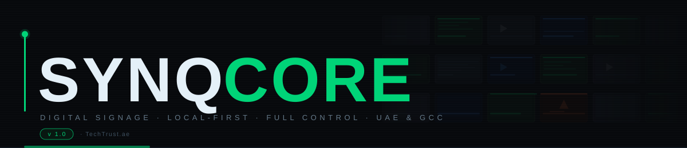
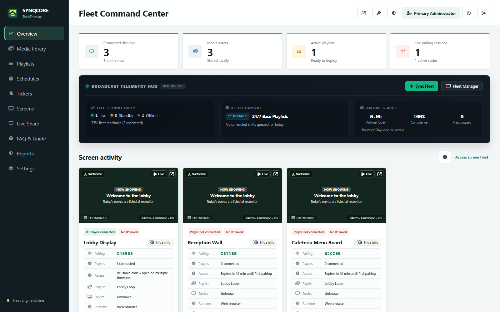
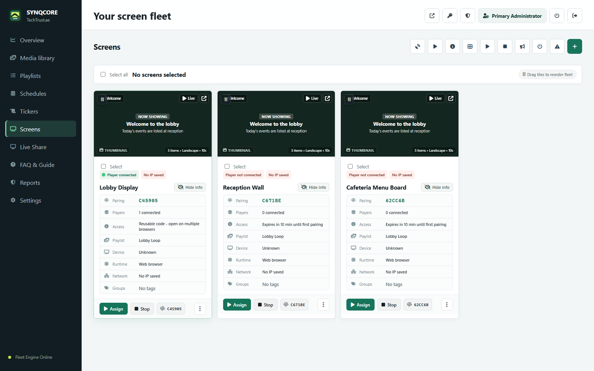
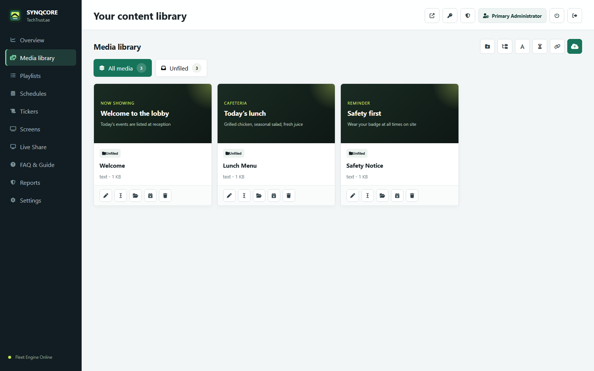
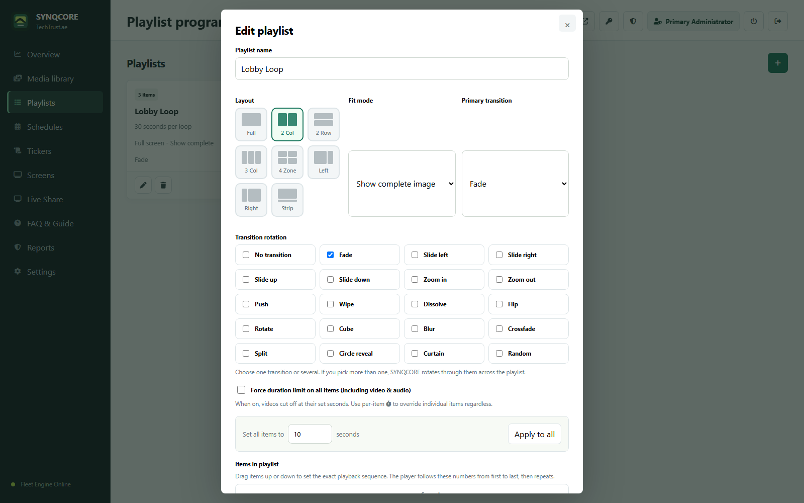
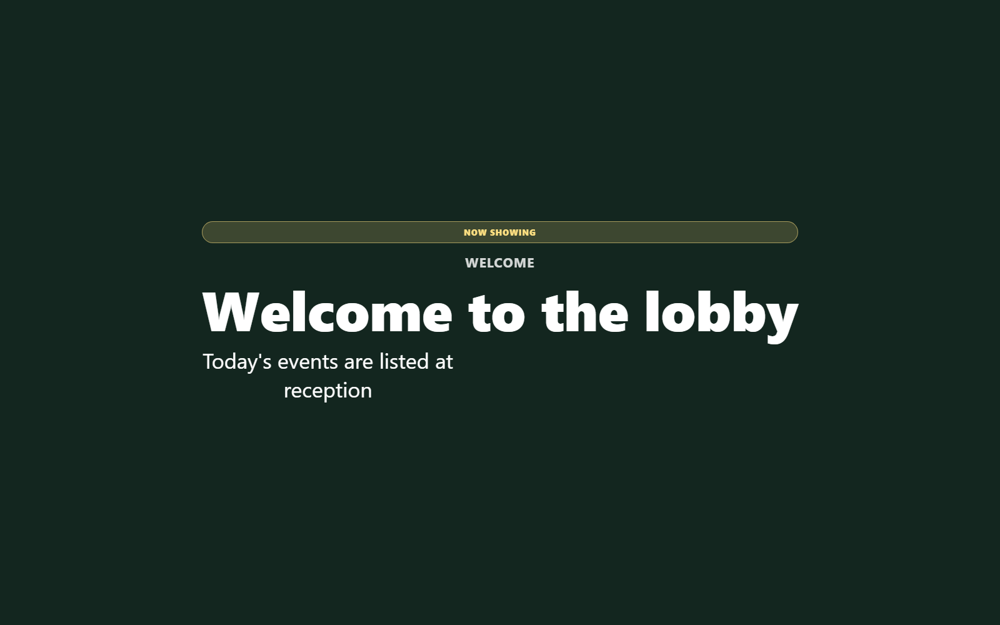

<div align="center">
  
</div>

<div align="center">

[](https://github.com/b34tl86/SynqCore/releases/latest)&nbsp;
[](#system-requirements)&nbsp;
[](LICENSE)

<br>

### Your Network. Your Content. Full Control.

**SynqCore is a professional digital signage platform for commercial screen networks.**<br>
It runs on your own Windows PC, with no cloud lock-in and no per-screen subscription.

<br>

## [⬇&nbsp; Download SynqCore for Windows](https://github.com/b34tl86/SynqCore/releases/latest)

<sub>Windows 10/11 · 64-bit · Installer includes everything it needs</sub>

<br>

[**Features**](#-core-features) &ensp;·&ensp; [**Screenshots**](#-screenshots) &ensp;·&ensp; [**Quick start**](#-quick-start) &ensp;·&ensp; [**Docs**](#-documentation) &ensp;·&ensp; [**TechTrust.ae**](https://techtrust.ae)

</div>

<br>

---

## What is SynqCore?

SynqCore turns one Windows PC on your network into the control room for every screen you run. You manage content from a browser dashboard; displays such as smart TVs, Raspberry Pi players, Android TV boxes, or any Chromium browser pair in seconds with a 6-digit code and update in real time.

Your media, schedules, and logs stay on your own hardware.

> Built for retail, corporate, hospitality, and institutional deployments across the UAE and GCC.

<br>

---

## 📸 Screenshots

<div align="center">
  
</div>

| Screens | Media library |
|:---:|:---:|
|  |  |
| **Layout picker** | **Player** |
|  |  |

<br>

---

## ✦ Core Features

|  |  |  |
|:--|:--|:--|
| **🖥 Screen management**<br>Pair any display in seconds with a 6-digit code. Live connection status. Organize by location, group, or tag. | **🎬 Rich media library**<br>Images, video, audio, PDF, PowerPoint and Office files, YouTube, IPTV streams, web pages, RSS, text slides, and countdowns. | **◼ Multi-zone layouts**<br>Split any screen into up to 4 independent content zones, chosen from 8 visual presets with one click. |
| **📅 Smart scheduling**<br>Time-based playlists per screen, with priority overrides, default playlists, and automatic switching. | **🚨 Emergency alerts**<br>Full-screen alerts with icon, message, and live countdown, sent to one screen, a group, or every screen at once. | **📰 Live tickers**<br>Scrolling text overlays that run independently of playlists, with per-screen speed, color, and position. |
| **🔐 Roles and MFA**<br>Admin, Manager, and Viewer roles. Multi-factor authentication per account. Sessions time out automatically. | **🎨 7 brand themes**<br>Studio Obsidian, Emerald, Ocean, Sunset, Violet, Crimson, or Custom, with your own logo and accent colors. | **📊 Proof of play**<br>Every impression is logged locally for compliance, auditing, and campaign reporting. |
| **📡 Live screen sharing**<br>Share a monitor to one, several, or all displays with low latency, including system audio where the browser supports it. | **🔍 Network discovery**<br>Scan your local network for compatible devices and add them without typing IP addresses. | **📂 Direct file presentation**<br>Present PowerPoint, Word, Excel, PDF, images, video, and HTML directly. Office files convert through Microsoft Office or LibreOffice. |

**🗜 Automatic video optimization** · Every uploaded video gets smaller copies in 720p and 1080p, plus 4K for 4K uploads, and each screen downloads only the size it needs.

<br>

---

## 🎬 Supported Content

```
🖼 Images  ·  🎥 Video  ·  🔊 Audio  ·  📄 PDF  ·  📊 PowerPoint / Office  ·  ▶ YouTube
📡 IPTV / HLS Streams  ·  🌐 Web Pages  ·  📝 Text Slides  ·  ⏳ Countdown Timers  ·  📰 RSS Feeds
```

<br>

---

## ⚡ Quick Start

**1. Install.** Download `SynqCore-Setup-v1.1.1.exe` from the [latest release](https://github.com/b34tl86/SynqCore/releases/latest) and run it. If Windows SmartScreen appears, choose **More info → Run anyway** ([why](docs/installation.md#windows-smartscreen)).

**2. Sign in.** SynqCore opens your dashboard at `http://localhost:8787`. Sign in as `admin` with password `admin`, then change the password straight away ([details](docs/installation.md#first-sign-in)).

**3. Pair a screen.** Go to **Screens → Add Screen**, then open the player address shown in the SynqCore tray menu on your display, for example `http://192.168.1.20:8787/player?code=ABC123`. Content goes live immediately. See [Pairing screens](docs/pairing-screens.md).

<br>

---

## System Requirements

| | Requirement |
|---|---|
| **Server** | Windows 10 or 11, 64-bit. Any always-on PC or mini PC on the same network as your screens. |
| **Admin** | Any modern browser on the network. |
| **Players** | Smart TV browser, Raspberry Pi, Android TV / Google TV / Fire TV, or any Chromium-based browser. |
| **Network** | Screens must reach the server on port 8787. The installer opens it for Private and Domain networks. |
| **Optional** | Microsoft Office or LibreOffice on the server to present PowerPoint and Word files. |

<br>

---

## 🗺 Roadmap

| &nbsp; | Version | Milestone |
|:---:|:---:|:---|
| ✅ | **v1.0** | Core CMS · Screen pairing · Multi-zone layouts · Emergency alerts · Tickers · Roles + MFA · 7 themes · Live sharing · Network discovery · Windows installer |
| ✅ | **v1.1** | Automatic video optimization · Per-screen video resolution · Clearer sign-in messages |
| 🔄 | **v1.2** | Bulk operations · Player health dashboard · Proof-of-play CSV/PDF export · Dayparting · Arabic (RTL) support |
| 📅 | **v1.5** | REST API + webhooks · Template designer · Widget library (weather, prayer times, scores) · Conditional content rules |
| 🔭 | **v2.0** | Multi-tenancy · Cloud hybrid option · Analytics dashboard · iOS/Android companion app |

<br>

---

## 📚 Documentation

| Guide | What it covers |
|---|---|
| [Installation](docs/installation.md) | Installing, first sign-in, SmartScreen, uninstalling |
| [Pairing screens](docs/pairing-screens.md) | Connecting displays and keeping them connected |
| [Player devices](players/README.md) | Raspberry Pi kiosk and Android TV setup |
| [FAQ](docs/faq.md) | Data location, network settings, updates, backups |
| [Changelog](CHANGELOG.md) | What's new in each release |
| [Security](SECURITY.md) | Reporting a vulnerability, hardening tips |
| [License](LICENSE) | SynqCore End User License Agreement |

<br>

---

<div align="center">

**SynqCore** &ensp;·&ensp; Built by [TechTrust.ae](https://techtrust.ae) &ensp;·&ensp; UAE

*Commercial signage for the real world. No cloud. No lock-in. Just screens.*

© 2026 TechTrust.ae · All rights reserved

</div>
